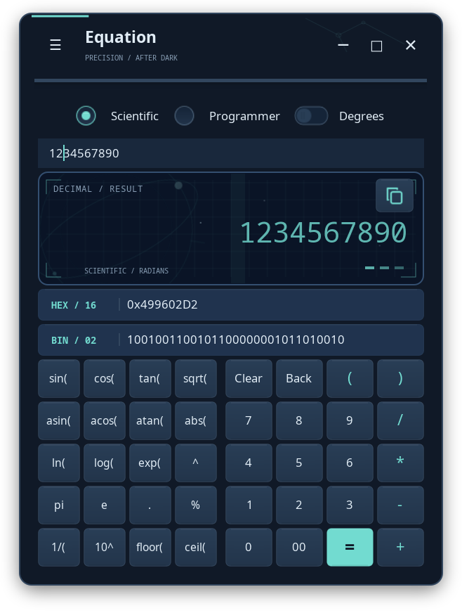
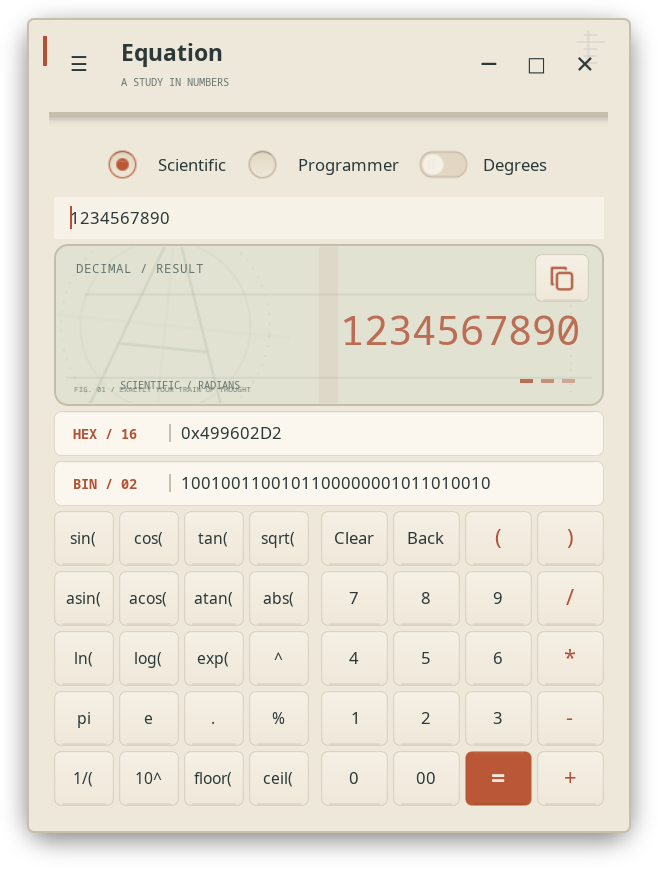
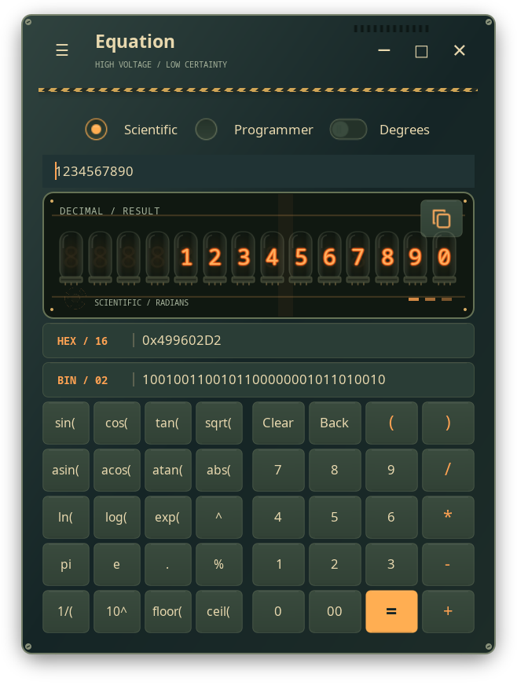

# Equation

A small, themeable calculator built with Elementary/EFL in C.
Scientific and programmer modes show results in decimal, hexadecimal, and binary.
Copy the main result with one click, and choose a theme from the **☰** menu.
In Programmer mode, choose **Input base: Decimal (10), Hex (16), or Binary (2)**
to enter numbers directly, such as `42`, `FF`, or `1010`. Mix bases using
`0d`, `0x`, and `0b` prefixes. Results always show all three bases.

Keyboard input stays in the expression entry when you click calculator controls.

Expressions follow BIDMAS: brackets, indices (powers), multiplication/division,
then addition/subtraction. Multiplication and division share precedence and run
left to right, as do addition and subtraction. In Scientific mode, `^` is a
right-associative power (`2^3^2 = 512`); in Programmer mode, `^` is bitwise XOR.

## Themes

<p align="center">
  <strong>Observatory</strong><br>
  
</p>

<p align="center">
  <strong>Atelier</strong><br>
  
</p>

<p align="center">
  <strong>Crazy Lab</strong><br>
  
</p>

## Build and install

Requires a C compiler, Meson, Ninja, pkg-config, EFL/Elementary 1.26 or newer
(with Eet, Ecore_File, Edje tools, and SVG support), and GNU gettext tools.

```sh
meson setup build --prefix=/usr/local
meson compile -C build
meson test -C build --print-errorlogs
meson install -C build
```

Use a writable install prefix, such as `--prefix="$HOME/.local"`, for a user install.
If EFL is installed under `/usr/local`, setup may need
`PKG_CONFIG_PATH=/usr/local/lib/pkgconfig`.

Run `equation` after installation, or `./build/src/fe-efl/equation` from the checkout.

The desktop launcher is `equation.desktop`, matching the application's window
identity on X11 and Wayland. If upgrading an older installation, remove its
obsolete `equation_calculator.desktop` from the same prefix's `share/applications`
directory and re-pin Equation if your dock still references that old launcher.

Settings are saved in `~/.config/equation/equation.eet` (or `$XDG_CONFIG_HOME/equation`).

[Usage and development](docs/equation_guide.md) ·
[Theme guide](docs/equation_themes.md) · [Translations](po/README.md)

GPLv2 only. See [COPYING](COPYING) and [AUTHORS](AUTHORS).

(c) enlightenment development team
